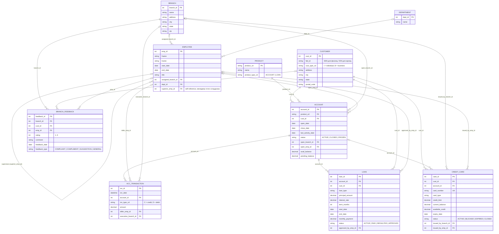

# SQL & Relational Databases Practice

[](#)
[](#)
[](#)
[](#)

A hands-on repository for learning how to design relational databases and write complex SQL queries. The project is based on the classic “Bank DB” domain (bank accounts, customers, branches, employee hierarchy, and financial transactions).

---

## Tech Stack & Roadmap

- [x] **SQLite3** — lightweight embedded engine for initial prototyping and offline practice.
- [x] **Docker & Docker Compose** — isolated PostgreSQL 16 container with persistent volumes and healthcheck.
- [x] **PostgreSQL 16 Migration** — full production-ready RDBMS migration (strict FK order, `SERIAL` keys, `NUMERIC` financial types, sequence alignment).
- [x] **Data Processing & Transformations (Chapter 7)** — robust string parsing, edge-case sanitization (`TRIM`, `STRPOS`), and PII data masking (`04_data_processing/pii_masking.sql`).
- [ ] **Advanced Querying** — window functions, CTEs, complex aggregations (`GROUPING SETS`, `ROLLUP`).
- [ ] **Performance & Optimization** — indexing strategies, execution plans with `EXPLAIN (ANALYZE, BUFFERS)`.

---

## ER Diagram of a Database (Bank DB)



---

## Quick Start

### 1. PostgreSQL 16 via Docker Compose (Primary Environment)

1. **Start the database container:**
   ```bash
   docker compose up -d
   ```

2. **Initialize schema, seed 1200+ records, and sync sequence counters:**
   ```bash
   cat db/schema_pg.sql db/seed.sql db/sync_sequences.sql | docker exec -i local_postgres psql -U dev_user -d bank_dev
   ```

3. **Connect to interactive `psql` console:**
   ```bash
   docker exec -it local_postgres psql -U dev_user -d bank_dev
   ```

4. **Fast execution alias (recommended):**
   ```bash
   alias r="docker exec -i local_postgres psql -U dev_user -d bank_dev < 04_data_processing/pii_masking.sql"
   ```

---

### 2. SQLite3 (Embedded / Offline Practice)

```bash
sqlite3 db/bank.db < db/schema.sql && sqlite3 db/bank.db < db/seed.sql
sqlite3 db/bank.db
```

---

## Repository Structure

```text
.
├── 01_basics/            # Basic query syntax, filtering, and ordering
├── 02_joins/             # Multi-table joins (INNER, LEFT, CROSS, self-joins)
├── 03_sets/              # Set theory operations (UNION, INTERSECT, EXCEPT)
├── 04_data_processing/   # Data manipulation (strings, dates, numbers, PII masking)
│   ├── pii_masking.sql        # Task 1: PII masking & safe address parsing
│   ├── tenure_calc.sql        # Task 2: Precise employee tenure & anniversary calculation
│   ├── billing_fee.sql        # Task 3: Fee calculation & roundoff error audit
│   └── account_passport.sql   # Task 4: Flat account passport with zero-division guard
├── 05_grouping/          # Aggregations & Grouping (Chapter 8: GROUP BY, HAVING, aggregates)
│   └── liquidity_audit.sql    # Task 1: Liquidity audit by branch and product
├── db/
│   ├── bank.db           # Pre-built SQLite database
│   ├── schema.sql        # SQLite DDL schema
│   ├── schema_pg.sql     # PostgreSQL DDL schema (SERIAL keys, strict FKs, NUMERIC)
│   ├── seed.sql          # 1200+ rows dataset (branches, customers, accounts, loans)
│   └── sync_sequences.sql # Sequence alignment script for PostgreSQL
├── docker-compose.yml    # Isolated PostgreSQL 16 service definition
└── README.md
```
